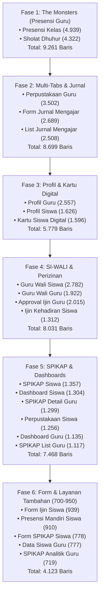

# 🗺️ 02. Roadmap & Tahapan Eksekusi Refactoring

Dokumen ini memetakan rencana kerja terstruktur (*Execution Roadmap*) untuk memecah 18 berkas monolitik secara bertahap tanpa mengganggu fungsionalitas aplikasi yang sudah berjalan.

---

## 1. Pembagian 5 Fase Refactoring

Refactoring dikelompokkan ke dalam 5 fase berdasarkan tingkat keparahan baris kode, kemiripan domain, dan risiko regresi:



---

## 2. Rincian Tiap Fase

### Fase 1: Presensi Kelas & Sholat Dhuhur (*The Monsters - 9.261 Baris*) - **[SELESAI ✅]**
- **Status:** Selesai direfaktor & teruji (*Zero Errors* Static Analysis). Lihat laporan lengkap di [`07-laporan-fase-1-presensi.md`](./07-laporan-fase-1-presensi.md).
- **Hasil Riil:**
  1. `lib/features/guru/screens/presensi_kelas_screen.dart`: **4.939 -> 514 baris** (-89,6%)
  2. `lib/features/guru/screens/presensi_sholat_dhuhur_screen.dart`: **4.322 -> 715 baris** (-83,5%)
- **Target File Asal:**
  1. `lib/features/guru/screens/presensi_kelas_screen.dart` (4.939 baris)
  2. `lib/features/guru/screens/presensi_sholat_dhuhur_screen.dart` (4.322 baris)
- **Mengapa Diprioritaskan Pertama:**
  Keduanya memiliki ukuran paling ekstrem (>4.000 baris) dan memiliki pola yang **90% identik**:
  - Modal input massal manual.
  - Modal input kehadiran satu siswa.
  - Matriks bulanan tanggal 1–31.
  - Modal kirim peringatan WhatsApp ortu.
  - Dialog cetak rekapitulasi PDF & Excel.
- **Hasil yang Diharapkan:**
  Komponen bersama presensi (misal: *Matrix Calendar Grid*, *WhatsApp Launcher*, *Export Options Dialog*) langsung terbentuk dan dapat dipakai ulang di fase-fase berikutnya. Layar utama turun menjadi **~250 baris**.

---

### Fase 2: Perpustakaan & Jurnal Mengajar (*Multi-Tabs & Stepper - 8.699 Baris*) - ✅ SELESAI
- **Status:** Selesai & Terverifikasi (Lihat [`08-laporan-fase-2-jurnal-dan-perpustakaan.md`](./08-laporan-fase-2-jurnal-dan-perpustakaan.md))
- **Target File:**
  1. `lib/features/guru/screens/perpustakaan_screen.dart` (3.502 -> **828 baris**, -76,4%)
  2. `lib/features/guru/screens/form_jurnal_mengajar_screen.dart` (2.689 -> **440 baris**, -83,6%)
  3. `lib/features/guru/screens/jurnal_mengajar_screen.dart` (2.508 -> **440 baris**, -82,5%)
- **Hasil:** File screen utama berkurang dari 8.699 baris menjadi 1.708 baris (-80,4%), modular widgets tersimpan rapi di `widgets/perpustakaan/`, `widgets/form_jurnal/`, dan `widgets/jurnal_mengajar/`. 0 error analisis statis.

---

### Fase 3: Profil Pendidik, Profil Siswa & Kartu Digital (*5.779 Baris*) - ✅ SELESAI
- **Status:** Selesai & Terverifikasi (Lihat [`09-laporan-fase-3-profil-dan-kartu.md`](./09-laporan-fase-3-profil-dan-kartu.md))
- **Target File:**
  1. `lib/features/guru/screens/profil_guru_screen.dart` (2.557 -> **847 baris**, -66,9%)
  2. `lib/features/siswa/screens/profil_siswa_screen.dart` (1.626 -> **699 baris**, -57,0%)
  3. `lib/features/siswa/screens/kartu_siswa_screen.dart` (1.596 -> **507 baris**, -68,2%)
- **Hasil:** File screen utama berkurang dari 5.779 baris menjadi 2.053 baris (-64,5%), modular widgets tersimpan rapi di `guru/screens/widgets/profil/`, `siswa/screens/widgets/profil/`, dan `siswa/screens/widgets/kartu/`. 0 error analisis statis.

---

### Fase 4: Bimbingan SI-WALI & Perizinan (*8.031 Baris*) - ✅ SELESAI
- **Status:** Selesai & Terverifikasi (Lihat [`10-laporan-fase-4-siwali-dan-ijin.md`](./10-laporan-fase-4-siwali-dan-ijin.md))
- **Target File:**
  1. `lib/features/siswa/screens/guru_wali_siswa_screen.dart` (2.782 -> **534 baris**, -80,8%)
  2. `lib/features/guru/screens/guru_wali_screen.dart` (1.922 -> **514 baris**, -73,3%)
  3. `lib/features/guru/screens/ijin_kehadiran_screen.dart` (2.015 -> **384 baris**, -81,0%)
  4. `lib/features/siswa/screens/ijin_kehadiran_siswa_screen.dart` (1.312 -> **446 baris**, -66,0%)
- **Hasil:** File screen utama berkurang dari 8.031 baris menjadi 1.878 baris (-76,6%), modular widgets tersimpan rapi di `siswa/screens/widgets/guru_wali/`, `guru/screens/widgets/guru_wali/`, `guru/screens/widgets/ijin/`, dan `siswa/screens/widgets/ijin/`. 0 error analisis statis.

---

### Fase 5: SPIKAP & Dashboard Utama (*7.468 Baris*) - ✅ SELESAI
- **Status:** Selesai & Terverifikasi (Lihat [`11-laporan-fase-5-spikap-dan-dashboard.md`](./11-laporan-fase-5-spikap-dan-dashboard.md))
- **Target File:**
  1. `lib/features/siswa/screens/dashboard_siswa_screen.dart` (1.304 -> **517 baris**, -60,4%)
  2. `lib/features/guru/screens/dashboard_guru_screen.dart` (1.135 -> **502 baris**, -55,8%)
  3. `lib/features/siswa/screens/perpustakaan_siswa_screen.dart` (1.256 -> **314 baris**, -75,0%)
  4. `lib/features/siswa/screens/spikap_siswa_screen.dart` (1.357 -> **358 baris**, -73,6%)
  5. `lib/features/guru/screens/spikap_screen.dart` (1.117 -> **480 baris**, -57,0%)
  6. `lib/features/guru/screens/spikap_detail_screen.dart` (1.299 -> **501 baris**, -61,4%)
- **Hasil:** File screen utama berkurang dari 7.468 baris menjadi 2.672 baris (-64,2%), 27 sub-komponen modular tersimpan rapi di `widgets/dashboard/`, `widgets/perpustakaan/`, dan `widgets/spikap/`. 0 error analisis statis.

---

### Fase 6: Formulir & Layanan Tambahan (*4.123 Baris*) - ✅ SELESAI
- **Status:** Selesai & Terverifikasi (Lihat [`13-laporan-fase-6-form-dan-layanan.md`](./13-laporan-fase-6-form-dan-layanan.md))
- **Target File:**
  1. `lib/features/siswa/screens/form_ijin_siswa_screen.dart` (939 -> **478 baris**, -49,1%)
  2. `lib/features/siswa/screens/presensi_siswa_screen.dart` (910 -> **206 baris**, -77,4%)
  3. `lib/features/siswa/screens/form_spikap_siswa_screen.dart` (778 -> **519 baris**, -33,3%)
  4. `lib/features/guru/screens/data_siswa_screen.dart` (777 -> **460 baris**, -40,8%)
  5. `lib/features/guru/screens/spikap_analitik_screen.dart` (719 -> **203 baris**, -71,8%)
- **Hasil:** File screen berkurang dari 4.123 baris menjadi 1.866 baris (-54,7%), 18 sub-komponen modular tersimpan rapi di domain widgets masing-masing. 0 error analisis statis.
- **Rilis Pasca-Fase 6:** Pembaruan versi aplikasi ke `v1.0.1` dan penyematan Git Tag `v1.0.1`.

---

## 3. SOP Standar Refactoring Satu Berkas (6 Langkah Teruji)

Untuk setiap berkas yang akan dipecah, ikuti 6 langkah teruji berikut:

```text
Langkah 1: Audit & Pemetaan Dependency
   ▼ Identifikasi: State lokal apa saja yang dipakai? Modal mana yang paling besar?
Langkah 2: Ekstraksi Modal & BottomSheet (Leaf Widgets)
   ▼ Potong modal terbesar dahulu (biasanya 500-900 baris) ke file baru di widgets/modals/.
   ▼ Buat static helper .show() dengan callback onSave / onRefresh.
Langkah 3: Ekstraksi Tab Views (Jika layar bertipe Multi-Tab)
   ▼ Pindahkan isi setiap tab ke widgets/tabs/tab_<nama>.dart.
Langkah 4: Ekstraksi Kartu & Item List (Reusable List Items)
   ▼ Pindahkan card widget berulang ke widgets/cards/.
Langkah 5: Ekstraksi Section Atas (Header Banner, KPI Stats, Filter Card)
   ▼ Pindahkan ke widgets/sections/.
Langkah 6: Bersihkan Berkas Screen Utama & Static Analysis
   ▼ Rampingkan screen utama hingga < 250 baris.
   ▼ Jalankan dart analyze untuk memastikan 0 error dan 0 warning.
```

---

## 4. Protokol Verifikasi & Manajemen Risiko

| Risiko | Dampak | Strategi Pencegahan |
| :--- | :--- | :--- |
| **State Desync** (Form tidak menyimpan perubahan) | Form gagal submit | Gunakan callback typed eksplisit `ValueChanged<T>` atau `onSave: Future<void> Function(...)`. |
| **Context Unmounted** | Exception saat pop modal | Selalu periksa `if (!mounted) return;` sebelum memanggil `Navigator.pop()` atau `ScaffoldMessenger`. |
| **Kompilasi Error Lintas File** | Build gagal | Lakukan refactoring satu fitur tuntas sebelum pindah ke fitur berikutnya. |
| **Regresi UI / Overflow** | Tampilan terpotong | Jalankan layout dengan widget `SafeArea` dan `SingleChildScrollView` / `LayoutBuilder` yang sudah ada tanpa mengubah constrain. |

