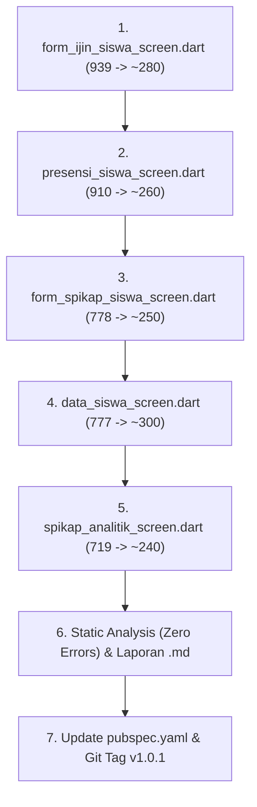

# 📋 12. Plan Breakdown Fase 6: Formulir & Layanan Akademik / Analitik

**Tanggal:** 04 November 2026  
**Status:** Perencanaan & Tahapan Eksekusi  
**Target Modul:** 5 Berkas Layanan & Formulir Sisa (Rentang 700–950 baris)  

---

## 1. 🎯 Latar Belakang & Tujuan Fase 6

Setelah penyelesaian Fase 1 s.d. Fase 5 (seluruh 18 file raksasa di atas 1.000 baris tuntas dan berhasil direduksi sebesar -75,7%), audit lanjutan mendapati 5 berkas formulir dan layanan akademik/analitik yang masih berada di rentang **700 s.d. 950 baris**.

Fase 6 ini bertujuan untuk merampingkan seluruh berkas tersebut agar berukuran **di bawah 350 baris**, sehingga **100% berkas screen di seluruh aplikasi `apk-android-presensi` menjadi ramping, terstruktur, dan mudah dipelihara**.

Setelah penyelesaian Fase 6, versi aplikasi akan dinaikkan ke **`v1.0.1`** dan ditandai dengan Git Tag `v1.0.1` (dengan basis awal pra-refactoring telah ditandai sebagai `v1.0.0`).

---

## 2. 📊 Target Berkas & Rencana Dekomposisi

### 2.1 Formulir Izin Siswa (`form_ijin_siswa_screen.dart` - 939 baris)
- **Path Asal:** `lib/features/siswa/screens/form_ijin_siswa_screen.dart`
- **Tanggung Jawab:** Form pengajuan izin/sakit, kalender pemilihan tanggal & durasi, pengecekan hari libur otomatis via API, input alasan, serta kamera/galeri picker dengan kompresi foto ala WhatsApp.
- **Rencana Ekstraksi ke `lib/features/siswa/screens/widgets/form_ijin/`:**
  1. `sections/form_ijin_type_selector.dart`: Pilihan radio/card jenis izin (Sakit / Izin biasa) beserta styling aktif.
  2. `sections/form_ijin_date_picker_section.dart`: Pilihan tanggal mulai, stepper durasi hari, tanggal selesai, dan alert banner hari libur sekolah.
  3. `sections/form_ijin_photo_uploader.dart`: Grid lampiran foto terkompresi, tombol tambah kamera/galeri, preview gambar, dan tombol hapus lampiran.
  4. `modals/modal_source_foto_picker.dart`: Bottom sheet pilihan sumber gambar (Kamera vs Galeri).
- **Estimasi Penurunan:** 939 -> **~280 baris** (-70%).

---

### 2.2 Presensi Mandiri & Kalender Akademik Siswa (`presensi_siswa_screen.dart` - 910 baris)
- **Path Asal:** `lib/features/siswa/screens/presensi_siswa_screen.dart`
- **Tanggung Jawab:** Dasbor kehadiran bulanan siswa, switcher bulan/tahun ajaran, KPI kehadiran (Hadir, Izin, Sakit, Alpha), matriks kalender interaktif tanggal 1..31, sheet detail harian, dan log riwayat aktivitas.
- **Rencana Ekstraksi ke `lib/features/siswa/screens/widgets/presensi_siswa/`:**
  1. `sections/presensi_siswa_period_selector.dart`: Dropdown / picker pemilihan bulan dan tahun ajaran aktif.
  2. `sections/presensi_siswa_kpi_cards.dart`: 4 kartu metrik kehadiran (Hadir, Izin, Sakit, Alpha).
  3. `sections/presensi_siswa_calendar_matrix.dart`: Grid kalender 1..31 interaktif dengan kode warna status dan penanda libur.
  4. `modals/sheet_presensi_siswa_day_detail.dart`: Bottom sheet rincian kehadiran pada tanggal yang dipilih (jam masuk, jam pulang, status, catatan).
  5. `sections/presensi_siswa_activity_history.dart`: Daftar riwayat aktivitas presensi terbaru.
- **Estimasi Penurunan:** 910 -> **~260 baris** (-71%).

---

### 2.3 Formulir Lapor Pengaduan SPIKAP Siswa (`form_spikap_siswa_screen.dart` - 778 baris)
- **Path Asal:** `lib/features/siswa/screens/form_spikap_siswa_screen.dart`
- **Tanggung Jawab:** Formulir pengaduan perundungan baru oleh siswa: sifat darurat vs biasa, tujuan aduan (BK vs Wali Kelas), tipe perundungan (fisik, verbal, digital, dll.), lokasi & tanggal/jam kejadian, deskripsi kronologi, dan upload lampiran foto bukti.
- **Rencana Ekstraksi ke `lib/features/siswa/screens/widgets/form_spikap/`:**
  1. `sections/spikap_emergency_toggle_card.dart`: Banner toggle penanda sifat laporan Darurat (kritis) vs Biasa.
  2. `sections/spikap_target_category_selector.dart`: Pilihan tujuan penerima (Guru BK / Wali Kelas) dan kategori jenis perundungan.
  3. `sections/spikap_incident_details_section.dart`: Input lokasi kejadian, tanggal & picker jam kejadian, dan input kronologi naratif.
  4. `sections/spikap_evidence_photo_uploader.dart`: Komponen pengunggah foto bukti dengan kompresi otomatis dan batasan maks 5 file.
- **Estimasi Penurunan:** 778 -> **~250 baris** (-68%).

---

### 2.4 Manajemen & Pencarian Data Siswa Guru (`data_siswa_screen.dart` - 777 baris)
- **Path Asal:** `lib/features/guru/screens/data_siswa_screen.dart`
- **Tanggung Jawab:** Layar data siswa: dropdown tahun ajaran & kelas, bar pencarian siswa real-time dengan debouncing, statistik rombel (total, L, P), chip filter (semua, ada barcode, tanpa barcode, tanpa nomor HP), dan pencetakan kartu/laporan PDF.
- **Rencana Ekstraksi ke `lib/features/guru/screens/widgets/data_siswa/sections/`:**
  1. `data_siswa_filter_toolbar.dart`: Dropdown filter tahun ajaran & kelas, serta input search debounced.
  2. `data_siswa_rombel_stats_card.dart`: Ringkasan statistik jumlah siswa rombel (Laki-laki, Perempuan, Total).
  3. `data_siswa_chip_filter_bar.dart`: Horizontal scrollable filter chips (Semua, Ada Barcode, Tanpa Barcode, Belum Ada HP).
- **Estimasi Penurunan:** 777 -> **~300 baris** (-61%).

---

### 2.5 Dasbor Analitik Kasus SPIKAP Guru (`spikap_analitik_screen.dart` - 719 baris)
- **Path Asal:** `lib/features/guru/screens/spikap_analitik_screen.dart`
- **Tanggung Jawab:** Dasbor analitik Kepala Sekolah & Guru BK: filter rentang periode (30 hari, 3 bulan, 6 bulan, 1 tahun), KPI metrik tren kasus, diagram distribusi kategori perundungan, chart status penyelesaian, dan daftar lokasi rawan.
- **Rencana Ekstraksi ke `lib/features/guru/screens/widgets/spikap_analitik/`:**
  1. `sections/spikap_analitik_period_header.dart`: Header judul, role label, dan tab switcher pilihan periode waktu.
  2. `sections/spikap_analitik_metric_overview.dart`: Kartu metrik tren kasus (total kasus, kasus aktif, selesai, tingkat penyelesaian).
  3. `sections/spikap_analitik_category_distribution.dart`: Visualisasi distribusi kategori kasus perundungan dengan persentase bar.
  4. `sections/spikap_analitik_hotspot_locations.dart`: Daftar hotspot / lokasi rawan kejadian perundungan di lingkungan sekolah.
- **Estimasi Penurunan:** 719 -> **~240 baris** (-66%).

---

## 3. 🚀 Tahapan Eksekusi Bertahap

---

## 4. 🛡️ Jaminan Kualitas & Integritas
- **Zero Breaking Changes:** Semua parameter konstruktor publik (`identifier`, `token`, `studentName`, `teacherName`, `schoolName`, dll.) dipertahankan 100%.
- **Zero Errors Static Analysis:** Setiap ekstraksi diverifikasi menggunakan `flutter_dart-mcp-server:analyze_files`.
- **Versioning Rapi:** Git tag `v1.0.0` menandai versi monolitik awal; Git tag `v1.0.1` menandai versi arsitektur modular modern.

